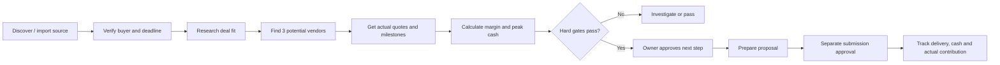

# Opportunity-to-Profit Workflow

Stages: NEW → VERIFIED_SOURCE → PRELIMINARY_FIT → VENDOR_SHORTLIST → QUOTES_RECEIVED → FINANCIAL_REVIEW → OWNER_APPROVAL → PROPOSAL_READY → PROPOSAL_SENT → WON | LOST | ARCHIVED.

The frontend supports local research and decisions, **not** external execution or signed commitments.

## Stage evidence
- New: sector, opportunity description, discovery date and source if available.
- Verified: authentic notice/source URL, actual buyer identity and live deadline.
- Vendor shortlist: qualified candidates, suitability notes, distinct source links.
- Quote received: quote amount and scope, lead time, validity and verified issuer.
- Financial review: client price/terms, direct cost, contingency, refundable deposits, upfront outlays, funding gap and owner work hours.
- Owner approval: explicit action and audit log; requires current diligence, compliance review and no gate failures.
- Proposal sent: future backend must require separate owner confirmation and delivery receipts.
- Won: evidence of executed agreement or purchase order, not a conversation.
- Realized contribution: actually received customer payments minus actually incurred direct project payments. A forecast never becomes realized automatically.

## Risk and cash policy
Cash exposure is conservatively calculated as upfront vendor + setup outflows + contingency reserve **without netting potentially refundable client deposits**. A documented, unrestricted and non-refundable collected deposit may be manually considered in a future audited backend; the browser MVP does not reduce cash exposure from deposits. Aggregate exposure across active accepted deals also must fit cap.

Financial cases with unknown or non-numeric values remain **research-only**, even if they show potentially attractive numbers.

## Procurement compliance
A government set-aside may limit how much a prime can subcontract and may impose requirements for similarly situated entities or who performs primary and vital work. Do not treat SDVOSB status, SAM registration or online listings as a substitute for procurement/legal checks. Evaluate solicitation-specific requirements and qualified counsel when needed.

## Decision log
Actions captured locally: research approved, request vendor investigation, pass, stage update, mark review needed. No action is interpreted as authority to send email, request a binding bid, or sign a contract.
